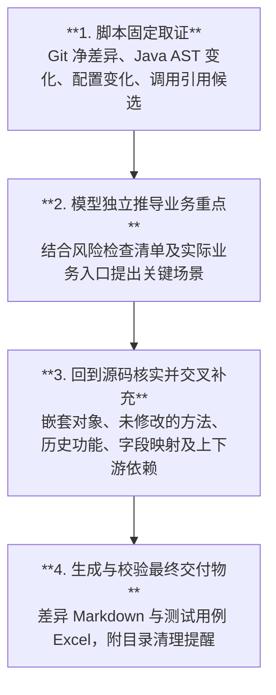

# diff-list（Windows 10）

直接指定 GitHub 或 GitLab URL 和 Git 提交号/范围，Skill 输出一份差异分析 Markdown 和单独的重点测试用例 Excel；每次脚本调用创建独立的无检出仓库副本，不访问本地业务工作区。要求 Git for Windows + Python 3.8+（标准库）；启用 Java AST 候选检查还需 **JDK 8 或更新版本**，并让 `javac` 和 `java` 可执行。私有 GitHub 或 GitLab 仓库使用本机 Git 凭据。

## Skill 当前实际工作流程



脚本输出是分析线索，不等于已确认的业务结论；模型必须回到指定修订的源码核实，并补充脚本未覆盖的影响。
## 交付内容

- **差异分析 Markdown**：描述业务变化、DDL、DML、配置、特殊逻辑和历史功能影响。第 5 章只记录 Excel 文件名和用例数量，测试内容不在报告里重复。
- **测试用例 Excel**：参考附件的“测试用例”工作表，固定五列：`用例编号`、`用例名称`、`前置条件`、`步骤描述`、`预期结果`；步骤与预期按顺序编号换行。

## 调用示例

```text
/diff-list https://github.com/lalala8462/webapi
修订：a1b2c3d4、e5f6a7b8
```

多项目分别提供 URL/修订，各自执行脚本后将结论合成同一报告。

## 固定脚本（PowerShell 5.1/7）

```powershell
py -3 .\scripts\collect_git.py --repo https://github.com/lalala8462/webapi --rev a1b2c3d4 --rev e5f6a7b8 --output G:\tmp\webapi-evidence.json
py -3 .\scripts\logic_candidates.py --repo https://github.com/lalala8462/webapi --rev a1b2c3d4 --rev e5f6a7b8 --output G:\tmp\webapi-logic.json
py -3 .\scripts\logic_candidates.py --repo https://github.com/lalala8462/adpts --base release-1 --head release-2 --output G:\tmp\adpts-logic.json
py -3 .\scripts\impact_candidates.py --repo https://github.com/lalala8462/webapi --rev YOUR_SHA --symbol processPayment
py -3 .\scripts\init_report.py --outdir G:\tmp --filename test-report.md
py -3 .\scripts\export_test_cases.py --input G:\tmp\test-cases.json --output G:\tmp\test-cases.xlsx
py -3 .\scripts\append_run_dirs.py G:\tmp\test-report.md --source G:\tmp\webapi-evidence.json --source G:\tmp\webapi-logic.json
py -3 .\scripts\validate_report.py G:\tmp\test-report.md --expect webapi=YOUR_FULL_40_CHARACTER_SHA
py -3 -m unittest discover -s tests -v
```

这些命令由 Skill 执行，用户只需提交 GitHub 或 GitLab 地址与修订号。`append_run_dirs.py` 的 `--source` 应包含本次全部取证和 AST JSON；执行了引用检索时，使用 `--clone` 追加每次 `impact_candidates.py` 输出的真实 `Analysis clone:` 路径。各脚本每运行一次都会创建新的目录，报告末尾必须列出所有目录。目录不会自动删除，用户可在后续验证完毕后自行删除。`--rev` 可重复，范围用 `--base/--head`；合并提交需要明确父节点，可写 `--rev SHA:2`。私有仓库凭据不可用时报告错误，不改用 HEAD 或其他源。

## 脚本分工

| 脚本 | 作用 |
| --- | --- |
| `repo_access.py` | 每次在 `%LOCALAPPDATA%\diff-list\runs` 新建独立目录，无检出克隆；目录保留，不复用旧缓存 |
| `collect_git.py` / `net_effect.py` | 按指定提交提取 diff，在临时索引合成净差异，提示未选中提交交叉 |
| `logic_candidates.py` / `java/JavaLogicAst.java` | 比较 Java 8 AST 的分支、调用、赋值、计算和返回值变化；对重命名做保守的节点匹配 |
| `config_candidates.py` | 对比 properties、普通 YAML 标量及 XML 属性映射的键值新增、删除与变更 |
| `impact_candidates.py` | 指定修订的符号字面引用检索，不进行类型精确绑定 |
| `export_test_cases.py` | 将模型核实的结构化 JSON 用例导出为五列 XLSX（Python 标准库，无额外依赖） |
| `init_report.py` / `append_run_dirs.py` / `validate_report.py` | 初始化差异报告、追加目录清理提示、校验结构和 Excel 摘要 |

## 测试用例数据及导出

模型根据变更影响及实际源码生成临时 `test-cases.json`，格式为：

```json
{"cases":[{"case_id":"DL0001","title":"旧报文兼容性验证","preconditions":"已具备旧版请求及测试环境","steps":["使用旧版报文发起请求","检查返回报文"],"expected":["请求满足已确认接口契约","原有响应字段保持正确"]}]}
```

`case_id` 可以省略，由脚本自动生成 `DL0001` 等编号。`steps`、`expected` 支持非空字符串或字符串数组；数组中的各项自动加序号。缺少可执行步骤、前提、预期或编号重复时导出失败，不自动补造动作。无重点场景时第 5 章填“无”，不生成 Excel。Excel 默认输出到 `G:\tmp`，已有文件不覆盖。内部 JSON 不应作为最终交付物。

## AST 候选规则和限制

针对最终净变化的 `.java` 文件，AST 扫描条件、状态赋值、异常、重试、锁、事务、配置读取、一般方法调用、算术表达式、赋值和返回值。按类/方法和语法节点匹配并对可唯一确定的重命名做身份归并，输出 `added/removed/modified`、风险类别、优先级、方法与源码行号（**内部证据**），不会自动把候选写进测试文档。只改格式的代码不应生成候选；代码里未改动的旧条件不应被写成新增。

风险优先级是**启发式**（例如状态、锁、事务或异常变化优先），不是实际业务风险的事实结论。AST 不执行 Java 类型检查、重载绑定或框架动态路由；对语法错误、过大文件、非 UTF-8、选中提交合成冲突，输出 `skipped`/`review_required`，不得声称无风险。Java 文件默认单文件最大 300 KB，离散提交最多自动读取 80 个变更 Java 文件（范围模式也受限），需人工分析被跳过的文件。

`DISCARDED_CALL` 标记独立表达式中的调用，不判断方法是否有返回值、返回值是否重要或是否存在副作用。`method_groups` 按文件和方法汇总变化及有限数量的调用名，仅供模型选取重点并沿调用关系查看指定修订的实际源码；未改动的被调方法不会因调用而自动扫描，不能据此断言依赖关系或分析覆盖完整。模型还须结合业务场景补充风险，并复核父提交及最终行为。

配置差异作为同一份内部候选 JSON 的 `CONFIG` 记录，包含键名、变更类型和可安全展示的布尔/整数值。密钥等敏感值被遮盖；复杂 YAML 和无法唯一解析的 XML 会列入 `skipped`，不推断运行时配置实际生效。配置候选不依赖 Java 编译器。

文档校验会忽略代码围栏内的 Markdown 标题，并按每条项目记录核对完整 SHA，不能仅凭项目名与 SHA 分别出现就放行。

**字段与历史功能影响**：对外报文、DTO/VO、表结构、Mapper/SQL 或消息契约发生变化时，必须补查旧消费者、历史记录、旧版本读写、旧查询/退款/通知链路。当前 AST 不保证识别纯字段声明或 DDL/Mapper 的所有语义变化，必须回到最终 Git diff 和指定修订源码分析。报告在“特殊逻辑与测试关注点”交代**既有功能影响**，存在高价值回归风险时在“重点测试场景”列具体条件及验收结果；不因缺少自动候选而判定无影响。

净差异 `composed/no_net_change/review_required` 只表示补丁合成结果，不证明最终业务行为；未选中提交可能影响间接调用。报告只能写核实过的业务逻辑及配置，源文件位置和证据 JSON 不应进入提测说明。证据可能含敏感内容，须保存在受控本机，不提交到仓库。已有输出文件不覆盖，默认目录为 `G:\tmp`，无法写入时报告错误。隔离目录不自动删除；旧版 `--cache-dir` 参数不再支持，避免指向业务工作区。
