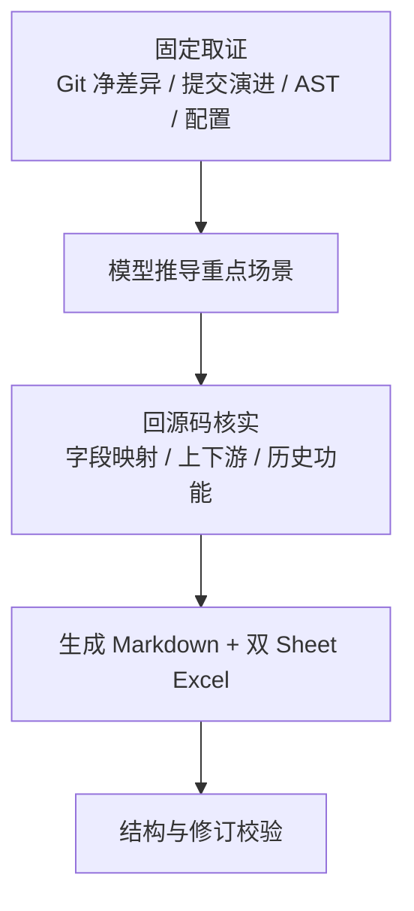

# diff-list（Windows 10）

输入 GitHub/GitLab 仓库 URL 与明确 Git 修订，输出差异分析 Markdown 和双 Sheet 测试用例 Excel。分析以**最终 Git 差异为范围底账**，提交说明、Java AST、配置变化和引用检索只提供线索，最终业务结论必须回到指定修订源码核实。

运行要求：Git for Windows、Python 3.8+；Java AST 需 JDK 8+。每次脚本调用在 `%LOCALAPPDATA%\diff-list\runs` 新建无检出仓库副本，不访问本地业务工作区，也不自动清理。

## 工作流程



## 输出

- Markdown：业务变化、DDL、DML、配置、特殊逻辑、提交演进风险、既有功能影响。第 5 章只写 Excel 文件名及重点/常规/总用例数量。
- Excel：`重点测试用例`、`常规功能用例` 两个 Sheet，统一五列：`用例编号`、`用例名称`、`前置条件`、`步骤描述`、`预期结果`。

## 调用示例

```text
/diff-list https://github.com/lalala8462/webapi
修订：a1b2c3d4、e5f6a7b8
```

多项目分别取证，最后合并为一份报告和一份 Excel。

## 固定脚本（PowerShell 5.1/7）

```powershell
py -3 .\scripts\collect_git.py --repo https://github.com/lalala8462/webapi --rev a1b2c3d4 --rev e5f6a7b8 --output G:\tmp\webapi-evidence.json
py -3 .\scripts\logic_candidates.py --repo https://github.com/lalala8462/webapi --rev a1b2c3d4 --rev e5f6a7b8 --output G:\tmp\webapi-logic.json
py -3 .\scripts\logic_candidates.py --repo https://github.com/lalala8462/adpts --base release-1 --head release-2 --output G:\tmp\adpts-logic.json
py -3 .\scripts\impact_candidates.py --repo https://github.com/lalala8462/webapi --rev YOUR_SHA --symbol processPayment
py -3 .\scripts\init_report.py --outdir G:\tmp --filename test-report.md
py -3 .\scripts\export_test_cases.py --input G:\tmp\test-cases.json --output G:\tmp\test-cases.xlsx
py -3 .\scripts\append_run_dirs.py G:\tmp\test-report.md --source G:\tmp\webapi-evidence.json --source G:\tmp\webapi-logic.json
py -3 .\scripts\validate_report.py G:\tmp\test-report.md --expect webapi=YOUR_FULL_40_CHARACTER_SHA
py -3 -m unittest discover -s tests -v
```

`--rev` 可重复；范围用 `--base/--head`；合并提交需指定 parent，例如 `--rev SHA:2`。凭据不可用时直接失败，不回退 HEAD。输出文件不覆盖。

执行过 `impact_candidates.py` 时，把其 `Analysis clone:` 路径通过 `append_run_dirs.py --clone` 加入报告；报告末尾必须列出本次全部分析目录并提示手动删除。

## 脚本分工

| 脚本 | 作用 |
| --- | --- |
| `repo_access.py` | 创建隔离无检出仓库 |
| `collect_git.py` / `net_effect.py` | 采集指定提交/范围并计算机械净效果 |
| `commit_review.py` | 提交说明、反复修改、文本反向候选；rename 前后保持同一文件身份 |
| `logic_candidates.py` / `JavaLogicAst.java` | Java 8 语法级分支、调用、状态、异常、事务、计算等候选 |
| `config_candidates.py` | properties、普通 YAML 标量、XML property/entry 键值差异 |
| `impact_candidates.py` | 指定修订的符号字面检索，不证明真实调用绑定 |
| `export_test_cases.py` | 双 Sheet XLSX、证据检查、覆盖点去重 |
| `init_report.py` / `append_run_dirs.py` / `validate_report.py` | 报告初始化、分析目录记录、结构校验 |

## 测试用例 JSON 示例

```json
{
  "focus_cases": [
    {
      "coverage_key": "refund.same-order.retry",
      "title": "重复退款幂等验证",
      "preconditions": "有可退款的原交易，首次退款已提交",
      "steps": ["重复提交相同退款单号", "检查退款状态及资金流水"],
      "expected": ["同一退款单号不得产生重复退款"],
      "observable_evidence": [
        {
          "surface": "数据库",
          "target": "已核实的退款流水记录",
          "assertion": "同一退款单号对应的实际退款流水数量=1"
        }
      ]
    }
  ],
  "regular_cases": [
    {
      "coverage_key": "refund.success.basic",
      "title": "正常退款处理",
      "preconditions": "存在允许退款的交易，金额符合限制",
      "steps": ["用新退款单号申请退款", "查询退款结果"],
      "expected": ["正常退款流程的请求与查询结果一致"],
      "observable_evidence": [
        {
          "surface": "接口",
          "target": "退款查询响应状态及退款单号",
          "assertion": "响应退款单号等于请求值，状态等于已确认的成功状态码"
        }
      ]
    }
  ]
}
```

示例仅说明格式。每条用例必须有可执行步骤、可判定预期和非空 `observable_evidence`；证据包含 `surface`、`target`、`assertion`。仅写“处理成功”“符合预期”“状态正确”会被拒绝。

`coverage_key`/`coverage_keys` 表示已核实的业务覆盖点。模型先做语义去重，脚本再机械检查：重点已完整覆盖的常规场景剔除，部分重叠要求拆分，组内重复报错。两组都为空时不生成 Excel；任一组有内容时两个 Sheet 都生成。兼容旧 `{"cases":[...]}` 输入，但新报告使用双组结构。

Markdown 第 5 章示例：

```text
Excel：test-cases.xlsx；重点用例数量：2；常规用例数量：3；总用例数量：5
```

## 关键限制

**提交演进**：按“提交说明 → 当次变化 → 最终净差异 → 最终源码”核实。提交说明不是正式需求；同文件多次修改和 `textual_reverse_candidate` 都只是线索。rename 会连续追踪；`no_net_change` 仍需检查中途撤销。范围超过 300 次提交或累计取证约 8 MB 时会标记历史复核不完整。

**离散提交净效果**：`net_effect.py` 在隔离索引中仅合成选中提交。冲突时返回 `review_required`，不会回退成 `base..last-selected`。

**Java AST**：只做语法级候选，不做完整类型解析、重载绑定或框架动态路由。默认最多 80 个 Java 文件、单文件 300 KB；匿名类使用外层作用域内稳定序号。语法错误、超限、非 UTF-8、补丁冲突或非预期 Git blob 读取失败进入 `skipped`，不得当作空文件或“无风险”。

**配置**：支持 properties、普通标量 YAML、XML `property/entry`。复杂运行时配置解析失败需要复核；POM、Mapper XML、CI workflow 等明显不属于该键值解析器目标的文件只记录跳过原因，不会单独触发全局 `review_required`。敏感值会遮盖。

**字段与历史功能**：请求/响应、DTO/VO、DB 字段、Mapper/SQL、RPC/MQ 契约变化时，即使没有 AST 候选，也必须检查真实映射、旧调用方、历史数据、旧版本以及查询/退款/关单/对账/通知等既有链路。

详细分析方法见 `references/analysis-checklist.md`；报告写法见 `references/report-rules.md`。

## 报告校验

先用 `assets/diff-list-template.md` 初始化报告，无内容章节写“无”；Mermaid 使用 `flowchart TD` 或 `sequenceDiagram`。完成后依次执行 Excel 导出、`append_run_dirs.py` 和 `validate_report.py`，再人工复核 Git 归属、候选、业务语义和测试预期。

报告不得包含本机源码路径、源码行号/内部证据、未决占位或真实密钥。结构校验 PASS 不证明 Mermaid 已实际渲染，也不证明动态绑定或业务预期正确。
